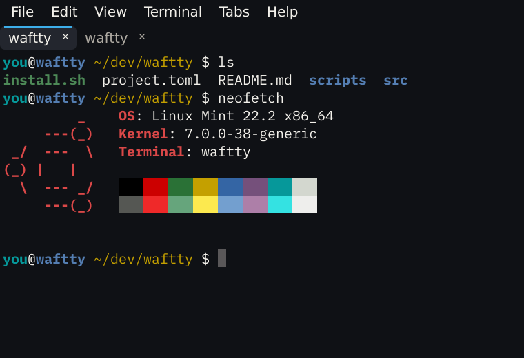

# waftty

[](https://github.com/danpozmanter/waftty/actions/workflows/test.yml)
[](https://github.com/danpozmanter/waftty/actions/workflows/release.yml)

**[Documentation](https://danpozmanter.github.io/waftty/)** | **[Releases](https://github.com/danpozmanter/waftty/releases)**



A tabbed terminal emulator for Linux, macOS, Windows and FreeBSD, written in
[Gossamer](https://github.com/gossamer-lang/gossamer) on gui-gos.

- Tabs, split panes, and a command palette (Ctrl+Shift+P, Cmd+Shift+P on macOS) for every command.
- Recent folders (Ctrl+Shift+R) and private windows and tabs that leave no history.
- Window tiling: a grid, columns, rows, or around a main window, kept tiled as windows open and close.
- A quick terminal (`waftty --quick`) that a global shortcut (F12) shows and hides.
- Settings for the shell, font, color schemes (imported from iTerm2, Windows Terminal, xfce4-terminal and base16), tiling and shortcuts.

## Install

Download a package from [Releases](https://github.com/danpozmanter/waftty/releases):

- Linux x86_64 (glibc 2.39+, as on Ubuntu 24.04): .deb, .rpm, AppImage or tarball.
- macOS 12+: one zip for Intel and one for Apple Silicon. Unzip it and double-click `install.command`.
- Windows x86_64: a setup program, or a zip (the `-portable.zip` keeps settings beside waftty).
- FreeBSD 15+ x86_64: a tarball.

[Installation](https://danpozmanter.github.io/waftty/installation/) has the details.

## Build

Needs Gossamer 0.84.3 or newer and Rust 1.95.0 through rustup.

```sh
gos fetch
gos run .                  # run it
gos run . --fixture        # self-test
./install.sh               # install to ~/.local, or /Applications on macOS
./install.sh --system      # Linux, FreeBSD: install to /usr/local
```
