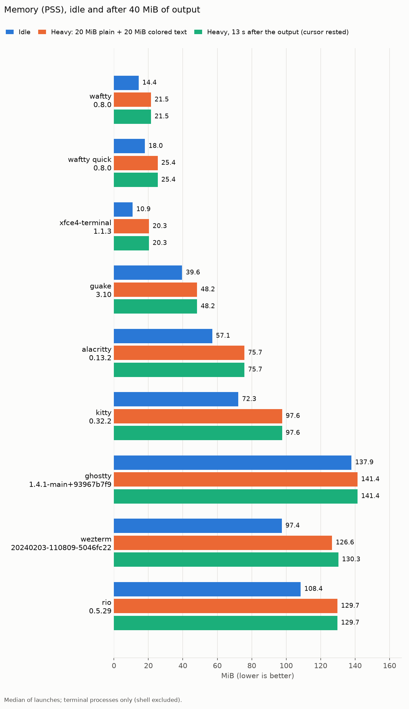
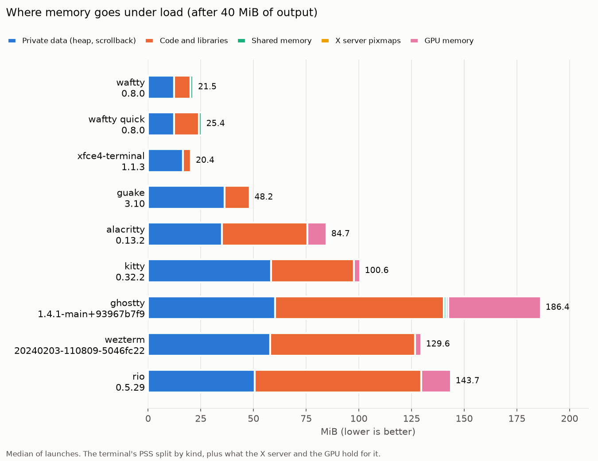
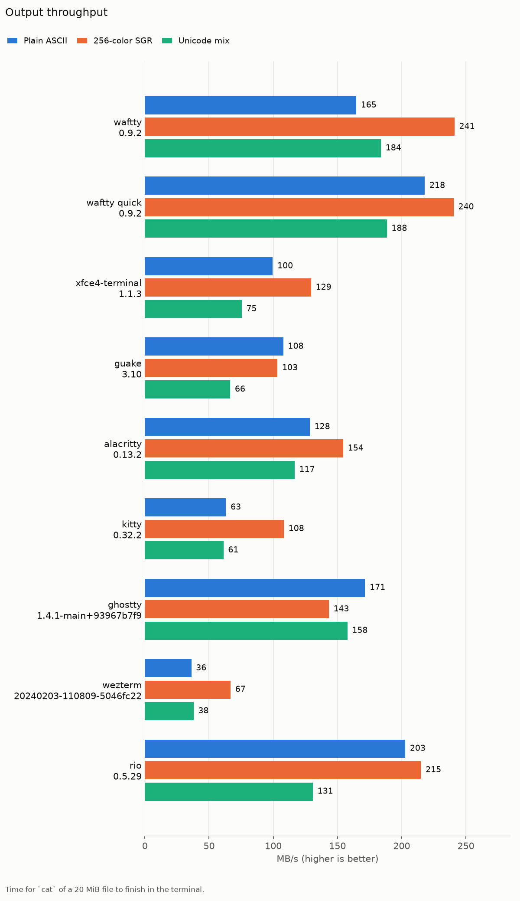
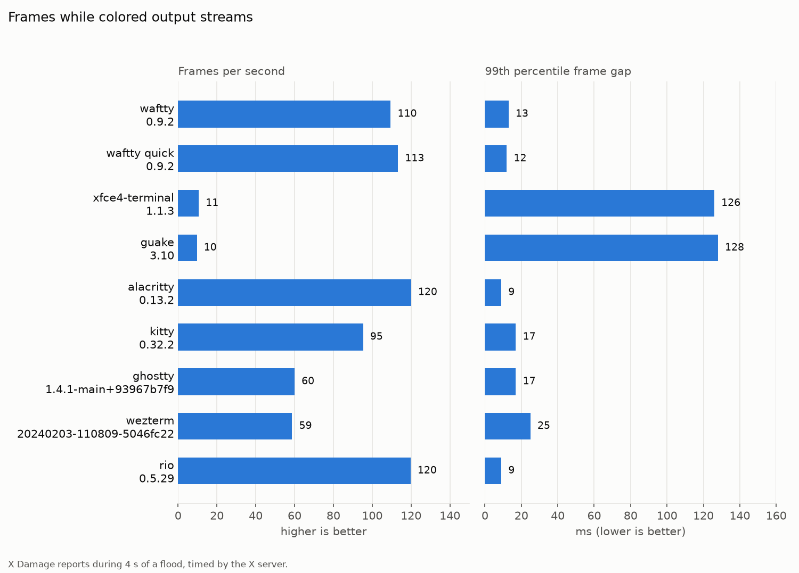
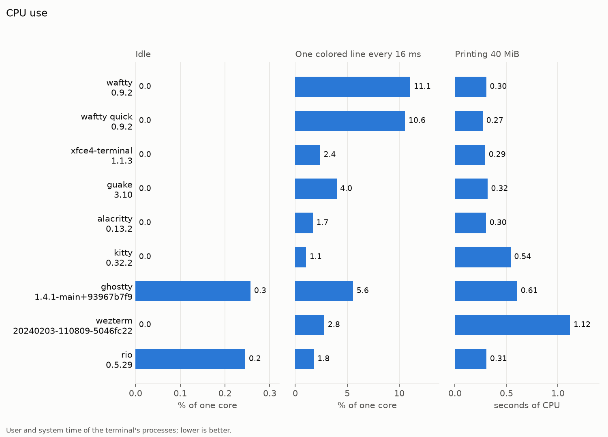
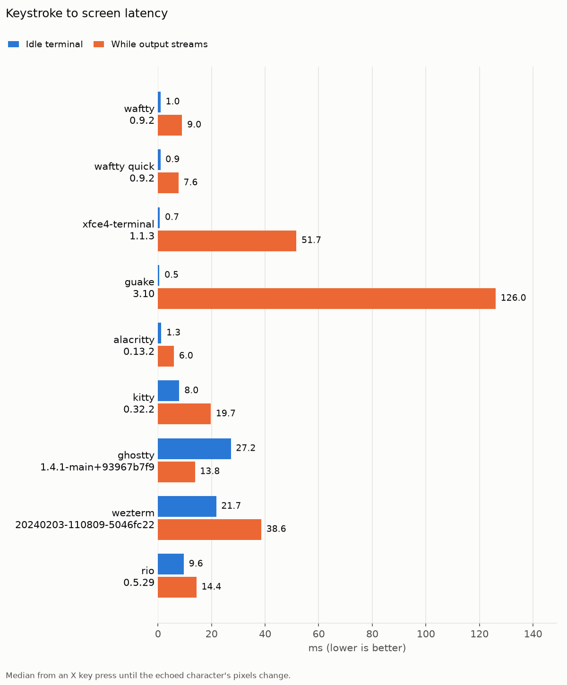
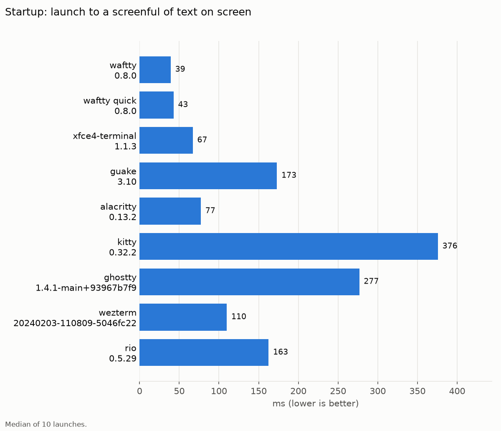

# Terminal benchmark

Scrollback 10000 lines, window [1000, 700], vsync off: False. The run took 23m 45s, finishing 2026-11-14 20:30 EST.

| Terminal | Version |
| --- | --- |
| waftty | waftty 0.8.0 |
| waftty quick | waftty 0.8.0 |
| xfce4-terminal | xfce4-terminal 1.1.3 (Xfce 4.18) |
| guake | Guake Terminal: 3.10 |
| alacritty | alacritty 0.13.2 |
| kitty | kitty 0.32.2 created by Kovid Goyal |
| ghostty | Ghostty 1.4.1-main+93967b7f9 |
| wezterm | wezterm 20240203-110809-5046fc22 |
| rio | rioterm 0.5.29 |

## Memory

The cursor-rested figures read the same memory again 13 seconds after the output, once a terminal that stops blinking its cursor has; what goes only then is held all the while the cursor blinks.

PSS shares each library page among the processes that map it; USS is the terminal's own. X server pixmaps and GPU memory are held elsewhere on the terminal's behalf.

| Terminal | Idle PSS | Idle USS | Heavy PSS | Heavy USS | Idle, cursor rested | Heavy, cursor rested | X server pixmaps | GPU |
| --- | ---: | ---: | ---: | ---: | ---: | ---: | ---: | ---: |
| waftty | 14.4 MiB | 12.9 MiB | 21.5 MiB | 20.0 MiB | 14.4 MiB | 21.5 MiB | 0.0 MiB | 0 MiB |
| waftty quick | 18.0 MiB | 16.5 MiB | 25.4 MiB | 23.9 MiB | 18.0 MiB | 25.4 MiB | 0.0 MiB | 0 MiB |
| xfce4-terminal | 10.9 MiB | 8.1 MiB | 20.3 MiB | 17.7 MiB | 10.9 MiB | 20.3 MiB | 0.1 MiB | 0 MiB |
| guake | 39.6 MiB | 33.8 MiB | 48.2 MiB | 42.3 MiB | 39.6 MiB | 48.2 MiB | 0.0 MiB | 0 MiB |
| alacritty | 57.1 MiB | 53.7 MiB | 75.7 MiB | 72.3 MiB | 57.1 MiB | 75.7 MiB | 0.0 MiB | 9 MiB |
| kitty | 72.3 MiB | 67.5 MiB | 97.6 MiB | 92.8 MiB | 74.3 MiB | 97.6 MiB | 0.0 MiB | 3 MiB |
| ghostty | 137.9 MiB | 126.2 MiB | 141.4 MiB | 129.6 MiB | 135.9 MiB | 141.4 MiB | 1.0 MiB | 44 MiB |
| wezterm | 97.4 MiB | 88.6 MiB | 126.6 MiB | 117.8 MiB | 100.9 MiB | 130.3 MiB | 0.0 MiB | 3 MiB |
| rio | 108.4 MiB | 99.9 MiB | 129.7 MiB | 121.2 MiB | 108.4 MiB | 129.7 MiB | 0.0 MiB | 14 MiB |

### Where the memory comes from

Each figure is the PSS of the terminal's own processes after 40 MiB of output. Left out are the shell and test commands, and the session bus a run starts for a single-instance terminal with the desktop services on it (the portal, and for xfce4-terminal xfconfd and gvfsd), which a desktop already runs. Private data is heap and other anonymous memory, scrollback included; code and libraries are mapped from files, each shared page divided among the processes that map it; X server pixmaps and GPU memory are held outside the terminal on its behalf and are not in its PSS.

| Terminal | Processes counted (MiB) | Left out (MiB) |
| --- | --- | --- |
| waftty | waftty 21.5 | sleep 0.1 |
| waftty quick | waftty 25.4 | sleep 0.1 |
| xfce4-terminal | xfce4-terminal 20.3 | sleep 0.1 |
| guake | guake 48.2 | sh 0.2, sleep 0.1 |
| alacritty | alacritty 75.7 | sleep 0.1 |
| kitty | kitty 97.6 | sleep 0.1 |
| ghostty | ghostty 141.4 | sleep 0.1 |
| wezterm | wezterm-gui 126.6 | sleep 0.1 |
| rio | rio 129.7 | sleep 0.1 |

| Terminal | Private data (heap, scrollback) | Code and libraries | Shared memory | X server pixmaps | GPU memory | Total |
| --- | ---: | ---: | ---: | ---: | ---: | ---: |
| waftty | 12.3 MiB | 7.8 MiB | 1.3 MiB | 0.0 MiB | 0.0 MiB | 21.5 MiB |
| waftty quick | 12.4 MiB | 11.6 MiB | 1.3 MiB | 0.0 MiB | 0.0 MiB | 25.4 MiB |
| xfce4-terminal | 16.5 MiB | 3.8 MiB | 0.1 MiB | 0.1 MiB | 0.0 MiB | 20.4 MiB |
| guake | 36.2 MiB | 12.0 MiB | 0.0 MiB | 0.0 MiB | 0.0 MiB | 48.2 MiB |
| alacritty | 35.1 MiB | 40.6 MiB | 0.0 MiB | 0.0 MiB | 9.0 MiB | 84.7 MiB |
| kitty | 58.4 MiB | 39.2 MiB | 0.0 MiB | 0.0 MiB | 3.0 MiB | 100.6 MiB |
| ghostty | 60.3 MiB | 80.1 MiB | 1.0 MiB | 1.0 MiB | 44.0 MiB | 186.4 MiB |
| wezterm | 58.0 MiB | 68.6 MiB | 0.0 MiB | 0.0 MiB | 3.0 MiB | 129.6 MiB |
| rio | 50.6 MiB | 79.1 MiB | 0.0 MiB | 0.0 MiB | 14.0 MiB | 143.7 MiB |

## Throughput

## Smoothness under load

| Terminal | Frames/s | Median gap | p99 gap | Longest gap | Echo median | Echo p95 |
| --- | ---: | ---: | ---: | ---: | ---: | ---: |
| waftty | 116 | 9 ms | 13 ms | 14 ms | 8.4 ms | 11.5 ms |
| waftty quick | 121 | 8 ms | 11 ms | 13 ms | 6.1 ms | 11.6 ms |
| xfce4-terminal | 11 | 96 ms | 126 ms | 126 ms | 51.7 ms | 148.2 ms |
| guake | 10 | 103 ms | 128 ms | 128 ms | 126.0 ms | 169.1 ms |
| alacritty | 120 | 8 ms | 9 ms | 9 ms | 6.0 ms | 10.9 ms |
| kitty | 95 | 9 ms | 17 ms | 18 ms | 19.7 ms | 23.7 ms |
| ghostty | 60 | 17 ms | 17 ms | 17 ms | 13.8 ms | 21.2 ms |
| wezterm | 59 | 17 ms | 25 ms | 25 ms | 38.6 ms | 55.5 ms |
| rio | 120 | 8 ms | 9 ms | 17 ms | 14.4 ms | 22.4 ms |

## CPU

| Terminal | Idle | One line every 16 ms | While 40 MiB print | CPU time for 40 MiB |
| --- | ---: | ---: | ---: | ---: |
| waftty | 0.00% | 8.9% | 141% | 0.32 s |
| waftty quick | 0.00% | 9.0% | 139% | 0.27 s |
| xfce4-terminal | 0.00% | 2.4% | 81% | 0.29 s |
| guake | 0.00% | 4.0% | 82% | 0.32 s |
| alacritty | 0.00% | 1.7% | 103% | 0.30 s |
| kitty | 0.01% | 1.1% | 96% | 0.54 s |
| ghostty | 0.26% | 5.6% | 197% | 0.61 s |
| wezterm | 0.00% | 2.8% | 124% | 1.12 s |
| rio | 0.25% | 1.8% | 95% | 0.31 s |

## Latency and startup

| Terminal | Plain | SGR | Unicode | Latency median | Latency p95 | Startup |
| --- | ---: | ---: | ---: | ---: | ---: | ---: |
| waftty | 147 MB/s | 229 MB/s | 186 MB/s | 0.6 ms | 0.8 ms | 39 ms |
| waftty quick | 203 MB/s | 243 MB/s | 184 MB/s | 0.5 ms | 0.9 ms | 43 ms |
| xfce4-terminal | 100 MB/s | 129 MB/s | 75 MB/s | 0.7 ms | 0.9 ms | 67 ms |
| guake | 108 MB/s | 103 MB/s | 66 MB/s | 0.5 ms | 0.9 ms | 173 ms |
| alacritty | 128 MB/s | 154 MB/s | 117 MB/s | 1.3 ms | 1.9 ms | 77 ms |
| kitty | 63 MB/s | 108 MB/s | 61 MB/s | 8.0 ms | 11.4 ms | 376 ms |
| ghostty | 171 MB/s | 143 MB/s | 158 MB/s | 27.2 ms | 33.6 ms | 277 ms |
| wezterm | 36 MB/s | 67 MB/s | 38 MB/s | 21.7 ms | 25.0 ms | 110 ms |
| rio | 203 MB/s | 215 MB/s | 131 MB/s | 9.6 ms | 15.5 ms | 163 ms |
