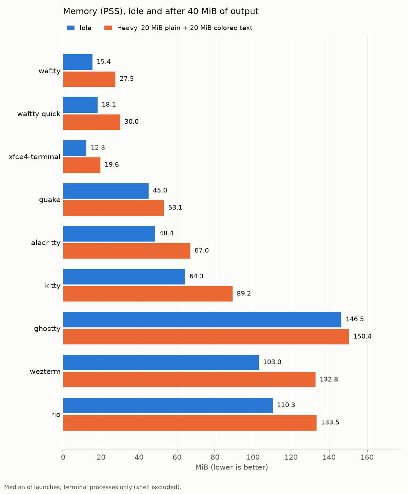
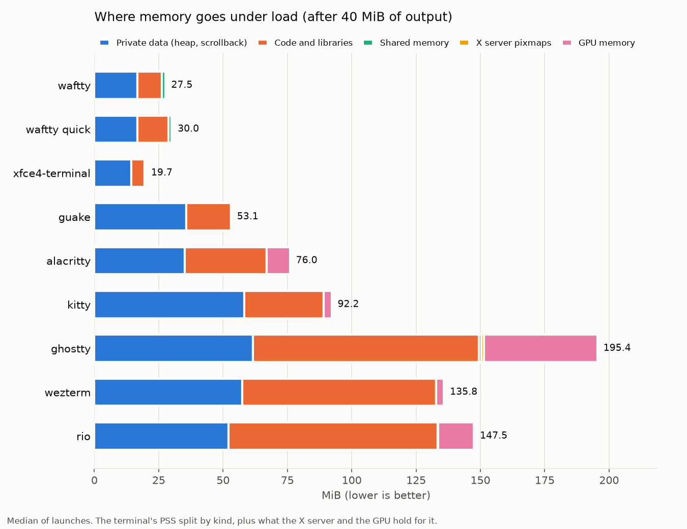
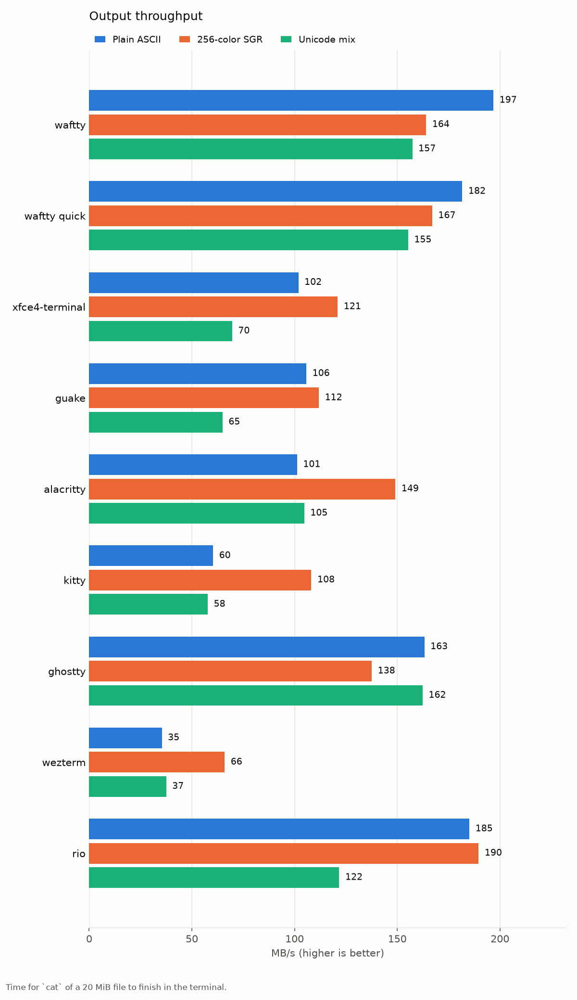
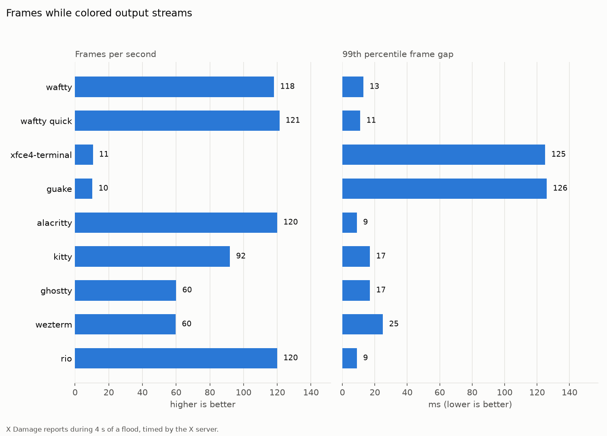
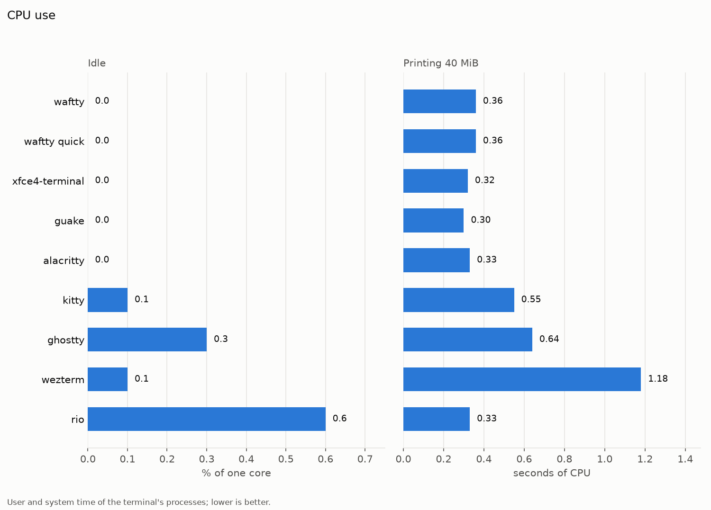
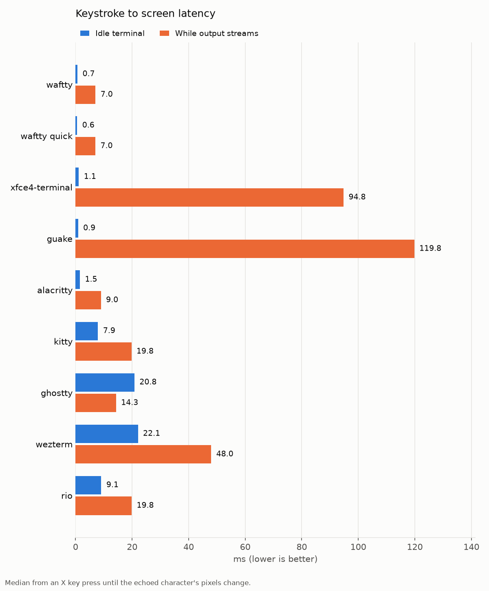

# Terminal benchmark

Scrollback 10000 lines, window [1000, 700], vsync off: False. The run took 10m 13s, finishing 2026-11-06 11:17 EST.

| Terminal | Version |
| --- | --- |
| waftty | waftty 0.5.4 |
| waftty quick | waftty 0.5.4 |
| xfce4-terminal | xfce4-terminal 1.1.3 (Xfce 4.18) |
| guake | Guake Terminal: 3.10 |
| alacritty | alacritty 0.13.2 |
| kitty | kitty 0.32.2 created by Kovid Goyal |
| ghostty | Ghostty 1.4.1-main+93967b7f9 |
| wezterm | wezterm 20240203-110809-5046fc22 |
| rio | rioterm 0.5.29 |

## Memory

PSS shares each library page among the processes that map it; USS is the terminal's own. X server pixmaps and GPU memory are held elsewhere on the terminal's behalf.

| Terminal | Idle PSS | Idle USS | Heavy PSS | Heavy USS | X server pixmaps | GPU |
| --- | ---: | ---: | ---: | ---: | ---: | ---: |
| waftty | 15.4 MiB | 13.9 MiB | 27.5 MiB | 26.0 MiB | 0.0 MiB | 0 MiB |
| waftty quick | 18.1 MiB | 16.6 MiB | 30.0 MiB | 28.5 MiB | 0.0 MiB | 0 MiB |
| xfce4-terminal | 12.3 MiB | 7.8 MiB | 19.6 MiB | 15.1 MiB | 0.1 MiB | 0 MiB |
| guake | 45.0 MiB | 37.6 MiB | 53.1 MiB | 45.6 MiB | 0.0 MiB | 0 MiB |
| alacritty | 48.4 MiB | 33.0 MiB | 67.0 MiB | 51.5 MiB | 0.0 MiB | 9 MiB |
| kitty | 64.3 MiB | 47.5 MiB | 89.2 MiB | 72.3 MiB | 0.0 MiB | 3 MiB |
| ghostty | 146.5 MiB | 110.6 MiB | 150.4 MiB | 114.9 MiB | 1.0 MiB | 44 MiB |
| wezterm | 103.0 MiB | 70.9 MiB | 132.8 MiB | 100.8 MiB | 0.0 MiB | 3 MiB |
| rio | 110.3 MiB | 75.7 MiB | 133.5 MiB | 98.9 MiB | 0.0 MiB | 14 MiB |

### Where the memory comes from

Each figure is the PSS of the terminal's own processes after 40 MiB of output. Left out are the shell and test commands, and the session bus a run starts for a single-instance terminal with the desktop services on it (the portal, and for xfce4-terminal xfconfd and gvfsd), which a desktop already runs. Private data is heap and other anonymous memory, scrollback included; code and libraries are mapped from files, each shared page divided among the processes that map it; X server pixmaps and GPU memory are held outside the terminal on its behalf and are not in its PSS.

| Terminal | Processes counted (MiB) | Left out (MiB) |
| --- | --- | --- |
| waftty | waftty 27.5 | sleep 0.2 |
| waftty quick | waftty 30.0 | sleep 0.2 |
| xfce4-terminal | xfce4-terminal 19.6 | sleep 0.2 |
| guake | guake 53.1 | sh 0.2, sleep 0.2 |
| alacritty | alacritty 67.0 | sleep 0.2 |
| kitty | kitty 89.2 | sleep 0.2 |
| ghostty | ghostty 150.4 | sleep 0.2 |
| wezterm | wezterm-gui 132.8 | sleep 0.2 |
| rio | rio 133.5 | sleep 0.2 |

| Terminal | Private data (heap, scrollback) | Code and libraries | Shared memory | X server pixmaps | GPU memory | Total |
| --- | ---: | ---: | ---: | ---: | ---: | ---: |
| waftty | 16.6 MiB | 9.5 MiB | 1.3 MiB | 0.0 MiB | 0.0 MiB | 27.5 MiB |
| waftty quick | 16.8 MiB | 11.9 MiB | 1.3 MiB | 0.0 MiB | 0.0 MiB | 30.0 MiB |
| xfce4-terminal | 14.3 MiB | 5.3 MiB | 0.1 MiB | 0.1 MiB | 0.0 MiB | 19.7 MiB |
| guake | 35.7 MiB | 17.4 MiB | 0.0 MiB | 0.0 MiB | 0.0 MiB | 53.1 MiB |
| alacritty | 35.2 MiB | 31.8 MiB | 0.0 MiB | 0.0 MiB | 9.0 MiB | 76.0 MiB |
| kitty | 58.3 MiB | 30.8 MiB | 0.0 MiB | 0.0 MiB | 3.0 MiB | 92.2 MiB |
| ghostty | 61.6 MiB | 87.9 MiB | 1.0 MiB | 1.0 MiB | 44.0 MiB | 195.4 MiB |
| wezterm | 57.4 MiB | 75.4 MiB | 0.0 MiB | 0.0 MiB | 3.0 MiB | 135.8 MiB |
| rio | 52.2 MiB | 81.3 MiB | 0.0 MiB | 0.0 MiB | 14.0 MiB | 147.5 MiB |

## Throughput

## Smoothness under load

| Terminal | Frames/s | Median gap | p99 gap | Longest gap | Echo median | Echo p95 |
| --- | ---: | ---: | ---: | ---: | ---: | ---: |
| waftty | 118 | 8 ms | 13 ms | 17 ms | 7.0 ms | 10.4 ms |
| waftty quick | 121 | 8 ms | 11 ms | 11 ms | 7.0 ms | 10.6 ms |
| xfce4-terminal | 11 | 103 ms | 125 ms | 125 ms | 94.8 ms | 188.8 ms |
| guake | 10 | 102 ms | 126 ms | 126 ms | 119.8 ms | 188.3 ms |
| alacritty | 120 | 8 ms | 9 ms | 9 ms | 9.0 ms | 13.2 ms |
| kitty | 92 | 9 ms | 17 ms | 17 ms | 19.8 ms | 25.4 ms |
| ghostty | 60 | 17 ms | 17 ms | 17 ms | 14.3 ms | 23.6 ms |
| wezterm | 60 | 17 ms | 25 ms | 25 ms | 48.0 ms | 54.7 ms |
| rio | 120 | 8 ms | 9 ms | 9 ms | 19.8 ms | 24.0 ms |

## CPU

| Terminal | Idle | While 40 MiB print | CPU time for 40 MiB |
| --- | ---: | ---: | ---: |
| waftty | 0.00% | 148% | 0.36 s |
| waftty quick | 0.00% | 146% | 0.36 s |
| xfce4-terminal | 0.00% | 86% | 0.32 s |
| guake | 0.00% | 81% | 0.30 s |
| alacritty | 0.00% | 103% | 0.33 s |
| kitty | 0.10% | 98% | 0.55 s |
| ghostty | 0.30% | 194% | 0.64 s |
| wezterm | 0.10% | 123% | 1.18 s |
| rio | 0.60% | 97% | 0.33 s |

## Latency and startup

| Terminal | Plain | SGR | Unicode | Latency median | Latency p95 | Startup |
| --- | ---: | ---: | ---: | ---: | ---: | ---: |
| waftty | 197 MB/s | 164 MB/s | 157 MB/s | 0.7 ms | 0.9 ms | 88 ms |
| waftty quick | 182 MB/s | 167 MB/s | 155 MB/s | 0.6 ms | 0.8 ms | 54 ms |
| xfce4-terminal | 102 MB/s | 121 MB/s | 70 MB/s | 1.1 ms | 1.2 ms | 57 ms |
| guake | 106 MB/s | 112 MB/s | 65 MB/s | 0.9 ms | 1.0 ms | 171 ms |
| alacritty | 101 MB/s | 149 MB/s | 105 MB/s | 1.5 ms | 2.8 ms | 91 ms |
| kitty | 60 MB/s | 108 MB/s | 58 MB/s | 7.9 ms | 11.6 ms | 386 ms |
| ghostty | 163 MB/s | 138 MB/s | 162 MB/s | 20.8 ms | 27.7 ms | 382 ms |
| wezterm | 35 MB/s | 66 MB/s | 37 MB/s | 22.1 ms | 24.4 ms | 70 ms |
| rio | 185 MB/s | 190 MB/s | 122 MB/s | 9.1 ms | 16.0 ms | 160 ms |
