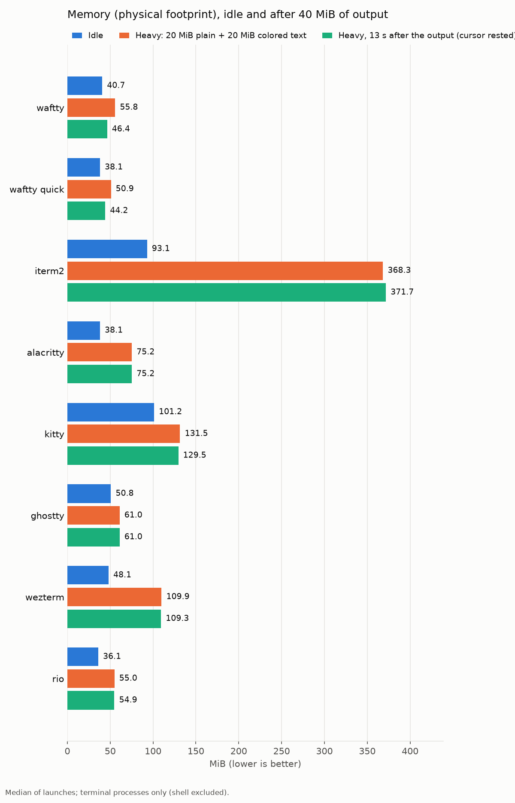
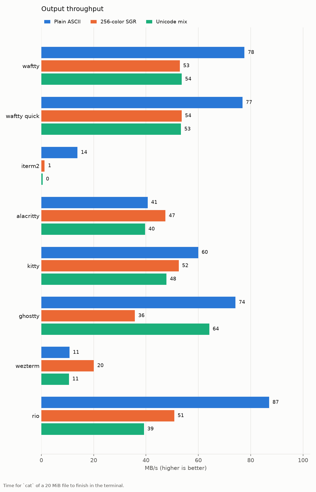
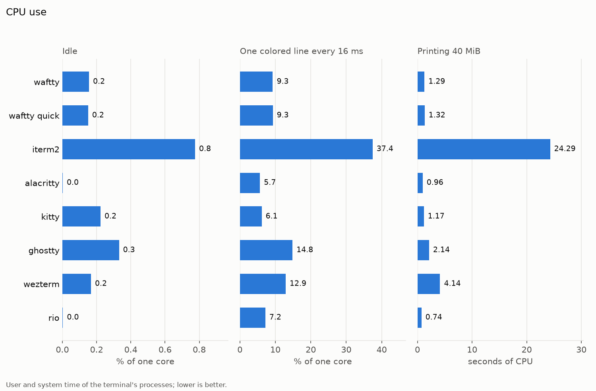
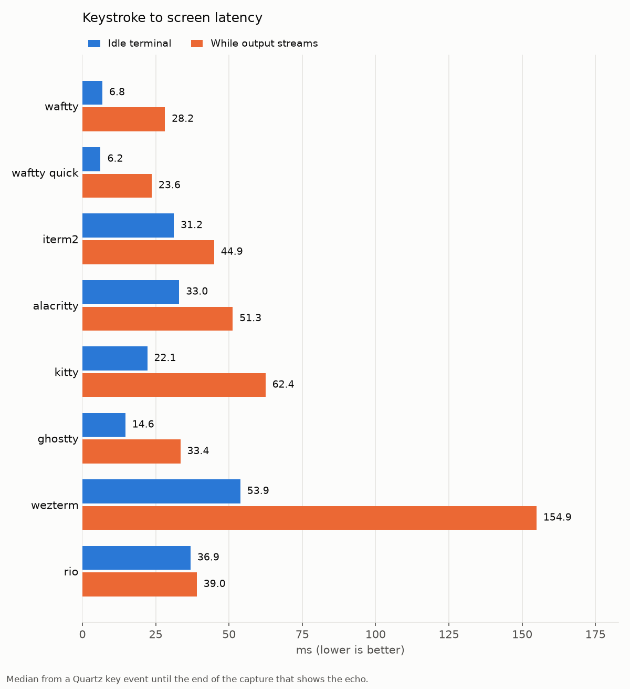
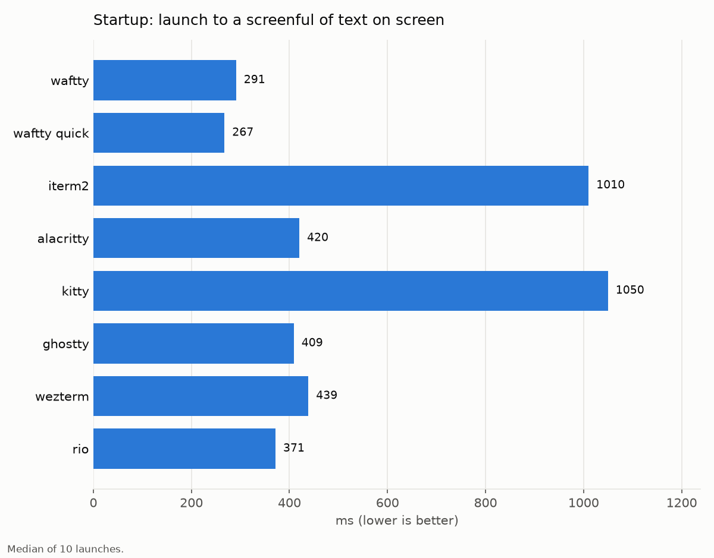

# Terminal benchmark

macOS 12.7, scrollback 10000 lines, window [1000, 700]. The display refreshes at 30 Hz. The run took 31m 29s, finishing 2026-11-11 14:40 EST.

| Terminal | Version |
| --- | --- |
| waftty | waftty 0.5.16 |
| waftty quick | waftty 0.5.16 |
| iterm2 | iterm2 3.0.15 |
| alacritty | alacritty 0.17.0 (94e7c88) |
| kitty | kitty 0.50.0 created by Kovid Goyal |
| ghostty | ghostty 1.4.0 |
| wezterm | wezterm 20240203-110809-5046fc22 |
| rio | rioterm 0.5.29 |

## Memory

The cursor-rested figures read the same memory again 13 seconds after the output, once a terminal that stops blinking its cursor has; what goes only then is held all the while the cursor blinks.

Physical footprint is the memory a process dirtied, compressed memory included, the figure Activity Monitor shows as Memory; RSS also counts the shared library pages it touches. Terminal processes only, shell excluded.

| Terminal | Idle footprint | Idle RSS | Heavy footprint | Heavy RSS | Idle, cursor rested | Heavy, cursor rested |
| --- | ---: | ---: | ---: | ---: | ---: | ---: |
| waftty | 40.7 MiB | 59.2 MiB | 55.8 MiB | 79.9 MiB | 40.5 MiB | 46.4 MiB |
| waftty quick | 38.1 MiB | 55.5 MiB | 50.9 MiB | 75.2 MiB | 37.9 MiB | 44.2 MiB |
| iterm2 | 93.1 MiB | 146.8 MiB | 368.3 MiB | 448.0 MiB | 61.5 MiB | 371.7 MiB |
| alacritty | 38.1 MiB | 39.3 MiB | 75.2 MiB | 76.7 MiB | 38.0 MiB | 75.2 MiB |
| kitty | 101.2 MiB | 126.3 MiB | 131.5 MiB | 147.6 MiB | 87.0 MiB | 129.5 MiB |
| ghostty | 50.8 MiB | 49.3 MiB | 61.0 MiB | 90.9 MiB | 50.8 MiB | 61.0 MiB |
| wezterm | 48.1 MiB | 51.5 MiB | 109.9 MiB | 119.6 MiB | 48.2 MiB | 109.3 MiB |
| rio | 36.1 MiB | 40.5 MiB | 55.0 MiB | 59.4 MiB | 36.0 MiB | 54.9 MiB |

## Throughput

## CPU

| Terminal | Idle | One line every 16 ms | While 40 MiB print | CPU time for 40 MiB |
| --- | ---: | ---: | ---: | ---: |
| waftty | 0.16% | 9.3% | 196% | 1.29 s |
| waftty quick | 0.15% | 9.3% | 200% | 1.32 s |
| iterm2 | 0.78% | 37.4% | 128% | 24.29 s |
| alacritty | 0.00% | 5.7% | 104% | 0.96 s |
| kitty | 0.22% | 6.1% | 159% | 1.17 s |
| ghostty | 0.33% | 14.8% | 238% | 2.14 s |
| wezterm | 0.17% | 12.9% | 133% | 4.14 s |
| rio | 0.00% | 7.2% | 113% | 0.74 s |

## Latency and startup

Each echo is timed at the end of the capture that first shows it, so a reading includes up to one capture's time.

| Terminal | Echo median | One capture |
| --- | ---: | ---: |
| waftty | 6.8 ms | 6.7 ms |
| waftty quick | 6.2 ms | 6.1 ms |
| iterm2 | 31.2 ms | 5.8 ms |
| alacritty | 33.0 ms | 7.8 ms |
| kitty | 22.1 ms | 5.1 ms |
| ghostty | 14.6 ms | 4.5 ms |
| wezterm | 53.9 ms | 6.6 ms |
| rio | 36.9 ms | 5.3 ms |

| Terminal | Plain | SGR | Unicode | Latency median | Latency p95 | Startup |
| --- | ---: | ---: | ---: | ---: | ---: | ---: |
| waftty | 78 MB/s | 53 MB/s | 54 MB/s | 6.8 ms | 10.7 ms | 291 ms |
| waftty quick | 77 MB/s | 54 MB/s | 53 MB/s | 6.2 ms | 10.6 ms | 267 ms |
| iterm2 | 14 MB/s | 1 MB/s | 0 MB/s | 31.2 ms | 52.3 ms | 1010 ms |
| alacritty | 41 MB/s | 47 MB/s | 40 MB/s | 33.0 ms | 42.7 ms | 420 ms |
| kitty | 60 MB/s | 52 MB/s | 48 MB/s | 22.1 ms | 39.0 ms | 1050 ms |
| ghostty | 74 MB/s | 36 MB/s | 64 MB/s | 14.6 ms | 26.0 ms | 409 ms |
| wezterm | 11 MB/s | 20 MB/s | 11 MB/s | 53.9 ms | 71.4 ms | 439 ms |
| rio | 87 MB/s | 51 MB/s | 39 MB/s | 36.9 ms | 56.1 ms | 371 ms |
