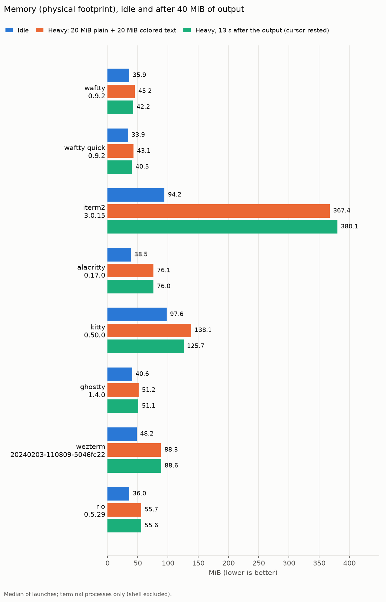
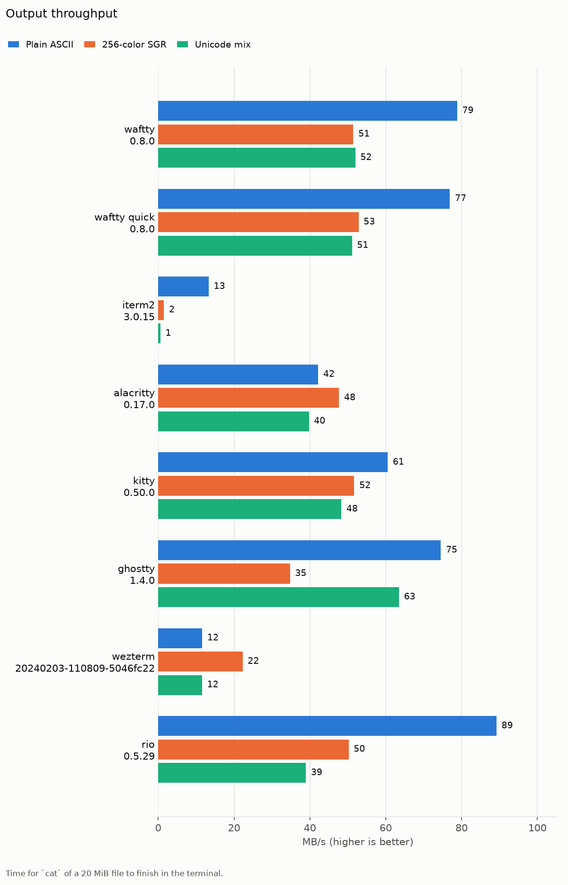
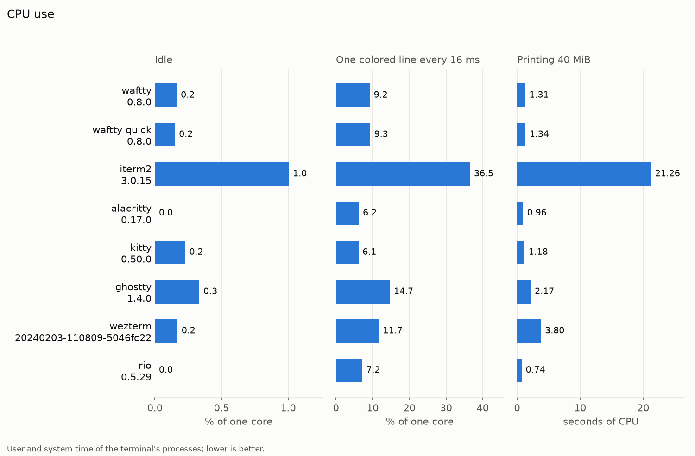
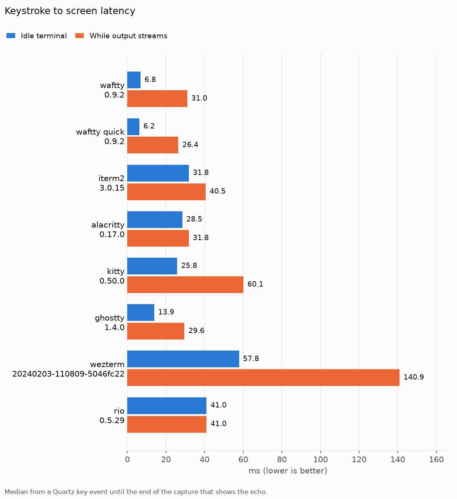
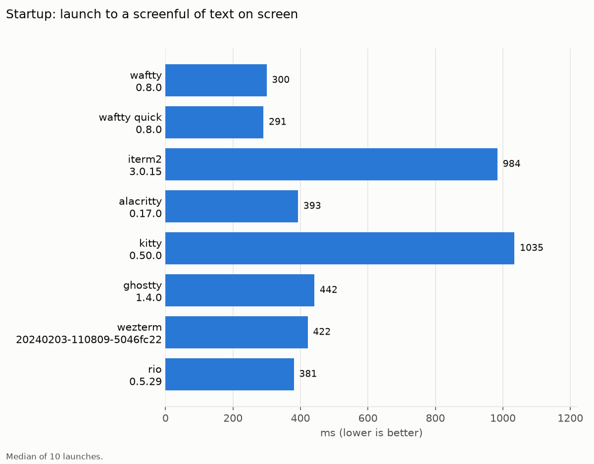

# Terminal benchmark

macOS 12.7, scrollback 10000 lines, window [1000, 700]. The display refreshes at 30 Hz. The run took 29m 28s, finishing 2026-11-14 20:09 EST.

| Terminal | Version |
| --- | --- |
| waftty | waftty 0.8.0 |
| waftty quick | waftty 0.8.0 |
| iterm2 | iterm2 3.0.15 |
| alacritty | alacritty 0.17.0 (94e7c88) |
| kitty | kitty 0.50.0 created by Kovid Goyal |
| ghostty | ghostty 1.4.0 |
| wezterm | wezterm 20240203-110809-5046fc22 |
| rio | rioterm 0.5.29 |

## Memory

The cursor-rested figures read the same memory again 13 seconds after the output, once a terminal that stops blinking its cursor has; what goes only then is held all the while the cursor blinks.

Physical footprint is the memory a process dirtied, compressed memory included, the figure Activity Monitor shows as Memory; RSS also counts the shared library pages it touches. Terminal processes only, shell excluded.

| Terminal | Idle footprint | Idle RSS | Heavy footprint | Heavy RSS | Idle, cursor rested | Heavy, cursor rested |
| --- | ---: | ---: | ---: | ---: | ---: | ---: |
| waftty | 36.1 MiB | 50.1 MiB | 45.5 MiB | 75.5 MiB | 36.1 MiB | 42.5 MiB |
| waftty quick | 33.5 MiB | 46.2 MiB | 42.5 MiB | 70.1 MiB | 33.4 MiB | 40.0 MiB |
| iterm2 | 94.2 MiB | 144.5 MiB | 367.4 MiB | 434.9 MiB | 62.4 MiB | 380.1 MiB |
| alacritty | 38.5 MiB | 39.7 MiB | 76.1 MiB | 77.5 MiB | 38.4 MiB | 76.0 MiB |
| kitty | 97.6 MiB | 127.0 MiB | 138.1 MiB | 171.8 MiB | 83.5 MiB | 125.7 MiB |
| ghostty | 40.6 MiB | 50.3 MiB | 51.2 MiB | 92.3 MiB | 40.6 MiB | 51.1 MiB |
| wezterm | 48.2 MiB | 52.3 MiB | 88.3 MiB | 120.0 MiB | 48.4 MiB | 88.6 MiB |
| rio | 36.0 MiB | 40.4 MiB | 55.7 MiB | 60.4 MiB | 35.9 MiB | 55.6 MiB |

## Throughput

## CPU

| Terminal | Idle | One line every 16 ms | While 40 MiB print | CPU time for 40 MiB |
| --- | ---: | ---: | ---: | ---: |
| waftty | 0.16% | 9.2% | 198% | 1.31 s |
| waftty quick | 0.15% | 9.3% | 200% | 1.34 s |
| iterm2 | 1.01% | 36.5% | 132% | 21.26 s |
| alacritty | 0.00% | 6.2% | 104% | 0.96 s |
| kitty | 0.23% | 6.1% | 159% | 1.18 s |
| ghostty | 0.33% | 14.7% | 234% | 2.17 s |
| wezterm | 0.17% | 11.7% | 135% | 3.80 s |
| rio | 0.00% | 7.2% | 112% | 0.74 s |

## Latency and startup

Each echo is timed at the end of the capture that first shows it, so a reading includes up to one capture's time.

| Terminal | Echo median | One capture |
| --- | ---: | ---: |
| waftty | 7.0 ms | 6.9 ms |
| waftty quick | 6.4 ms | 6.3 ms |
| iterm2 | 31.8 ms | 5.8 ms |
| alacritty | 28.5 ms | 7.1 ms |
| kitty | 25.8 ms | 5.7 ms |
| ghostty | 13.9 ms | 5.2 ms |
| wezterm | 57.8 ms | 6.9 ms |
| rio | 41.0 ms | 7.6 ms |

| Terminal | Plain | SGR | Unicode | Latency median | Latency p95 | Startup |
| --- | ---: | ---: | ---: | ---: | ---: | ---: |
| waftty | 79 MB/s | 51 MB/s | 52 MB/s | 7.0 ms | 7.8 ms | 300 ms |
| waftty quick | 77 MB/s | 53 MB/s | 51 MB/s | 6.4 ms | 13.1 ms | 291 ms |
| iterm2 | 13 MB/s | 2 MB/s | 1 MB/s | 31.8 ms | 55.5 ms | 984 ms |
| alacritty | 42 MB/s | 48 MB/s | 40 MB/s | 28.5 ms | 41.8 ms | 393 ms |
| kitty | 61 MB/s | 52 MB/s | 48 MB/s | 25.8 ms | 38.9 ms | 1035 ms |
| ghostty | 75 MB/s | 35 MB/s | 63 MB/s | 13.9 ms | 27.3 ms | 442 ms |
| wezterm | 12 MB/s | 22 MB/s | 12 MB/s | 57.8 ms | 71.7 ms | 422 ms |
| rio | 89 MB/s | 50 MB/s | 39 MB/s | 41.0 ms | 54.5 ms | 381 ms |
