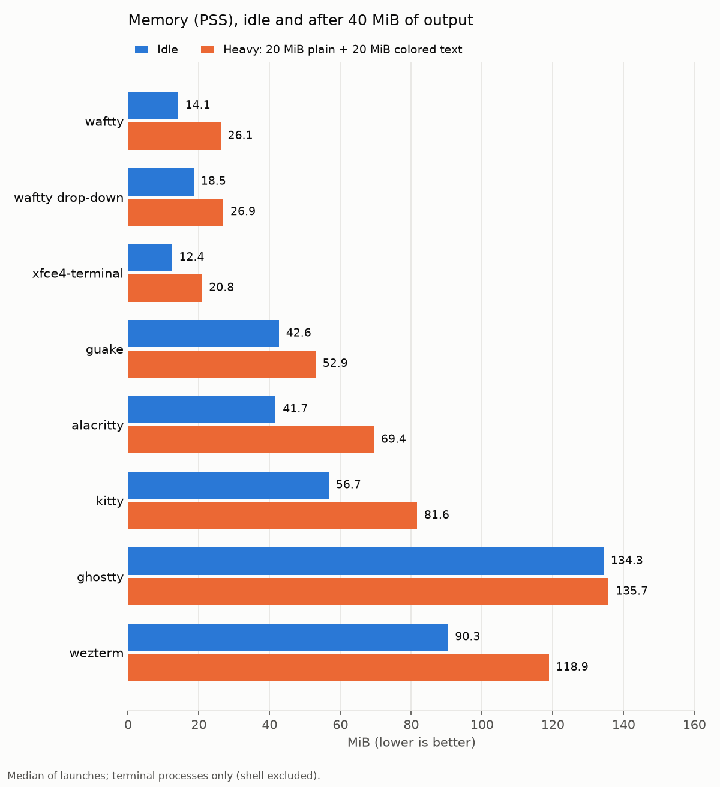
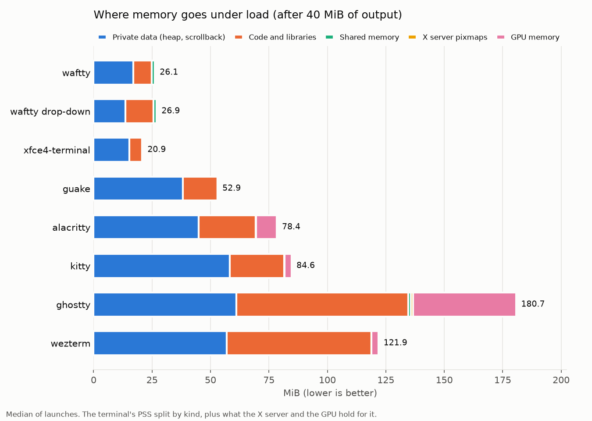
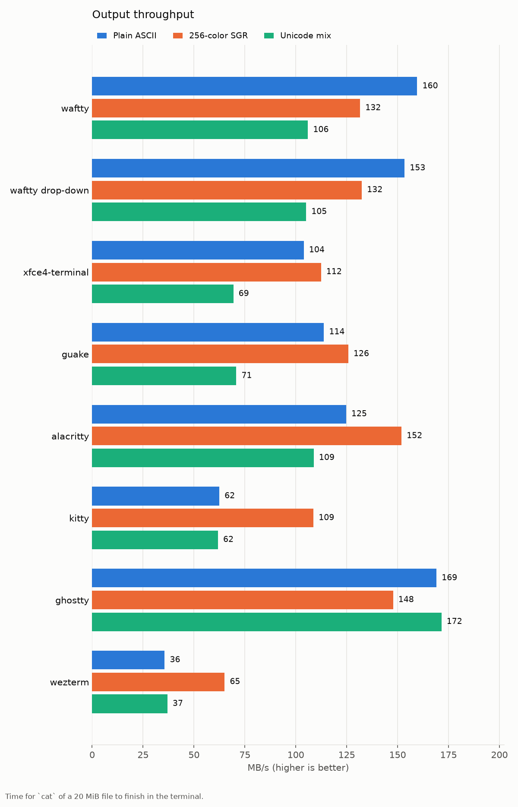
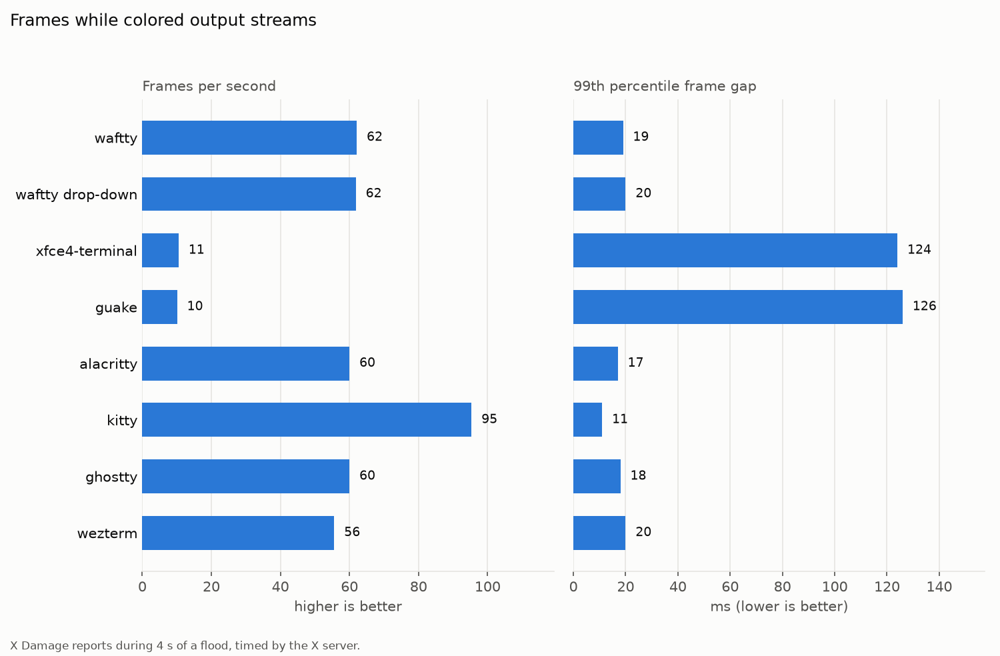
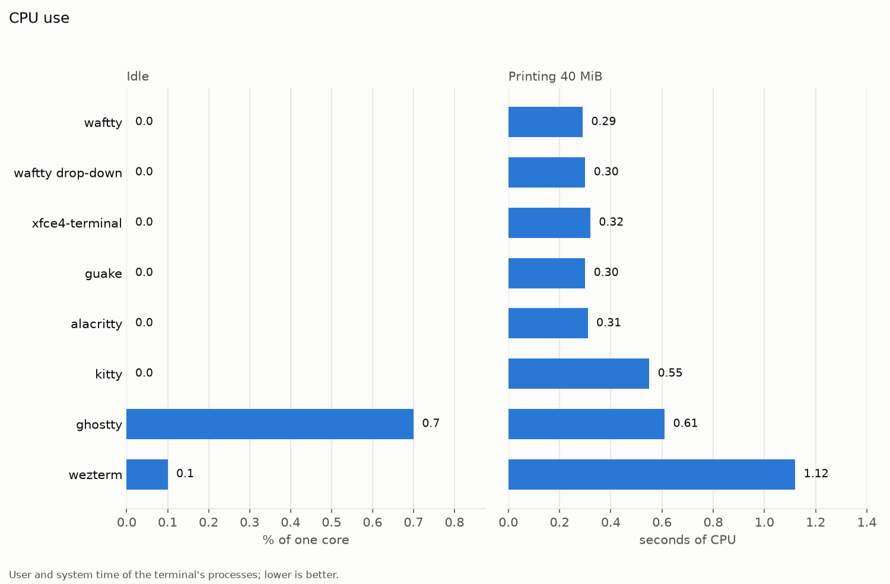
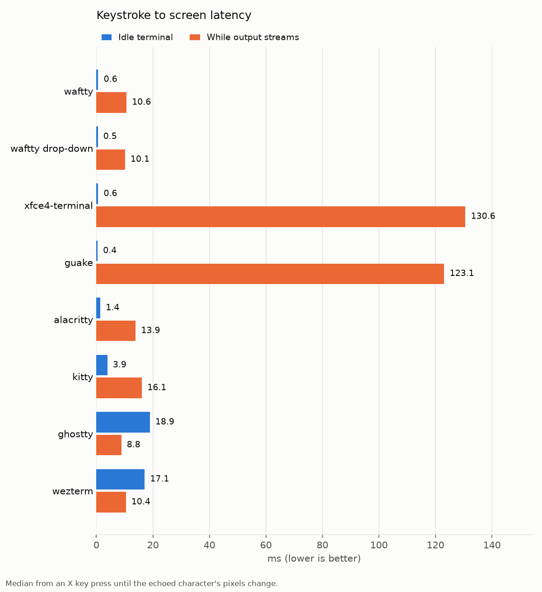
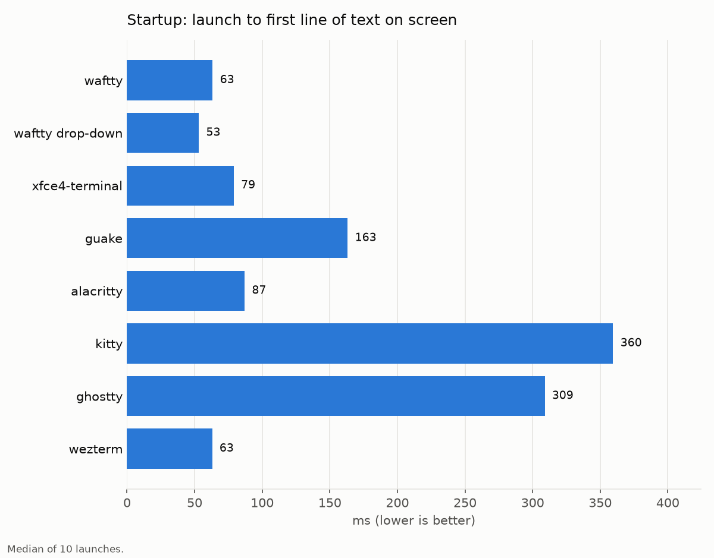

# Terminal benchmark

Scrollback 10000 lines, window [1000, 700], vsync off: True.

| Terminal | Version |
| --- | --- |
| waftty | waftty 0.4.0 |
| waftty drop-down | waftty 0.4.0 |
| xfce4-terminal | xfce4-terminal 1.1.3 (Xfce 4.18) |
| guake | Guake Terminal: 3.10 |
| alacritty | alacritty 0.13.2 |
| kitty | kitty 0.32.2 created by Kovid Goyal |
| ghostty | Ghostty 1.4.1-main+93967b7f9 |
| wezterm | wezterm 20240203-110809-5046fc22 |

## Memory

PSS shares each library page among the processes that map it; USS is the terminal's own. X server pixmaps and GPU memory are held elsewhere on the terminal's behalf.

| Terminal | Idle PSS | Idle USS | Heavy PSS | Heavy USS | X server pixmaps | GPU |
| --- | ---: | ---: | ---: | ---: | ---: | ---: |
| waftty | 14.1 MiB | 12.6 MiB | 26.1 MiB | 24.6 MiB | 0.0 MiB | 0 MiB |
| waftty drop-down | 18.5 MiB | 17.0 MiB | 26.9 MiB | 25.4 MiB | 0.0 MiB | 0 MiB |
| xfce4-terminal | 12.4 MiB | 8.0 MiB | 20.8 MiB | 16.5 MiB | 0.1 MiB | 0 MiB |
| guake | 42.6 MiB | 35.5 MiB | 52.9 MiB | 45.9 MiB | 0.0 MiB | 0 MiB |
| alacritty | 41.7 MiB | 33.2 MiB | 69.4 MiB | 61.0 MiB | 0.0 MiB | 9 MiB |
| kitty | 56.7 MiB | 47.1 MiB | 81.6 MiB | 72.0 MiB | 0.0 MiB | 3 MiB |
| ghostty | 134.3 MiB | 109.5 MiB | 135.7 MiB | 110.8 MiB | 1.0 MiB | 44 MiB |
| wezterm | 90.3 MiB | 69.1 MiB | 118.9 MiB | 97.7 MiB | 0.0 MiB | 3 MiB |

### Where the memory comes from

Each figure is the PSS of the terminal's own processes after 40 MiB of output. Left out are the shell and test commands, and the session bus a run starts for a single-instance terminal (dbus-run-session, dbus-daemon, and for xfce4-terminal xfconfd and gvfsd), which a desktop already runs. Private data is heap and other anonymous memory, scrollback included; code and libraries are mapped from files, each shared page divided among the processes that map it; X server pixmaps and GPU memory are held outside the terminal on its behalf and are not in its PSS.

| Terminal | Processes counted (MiB) | Left out (MiB) |
| --- | --- | --- |
| waftty | waftty 26.1 | sleep 0.1 |
| waftty drop-down | waftty 26.9 | dbus-daemon 0.9, dbus-run-session 0.3, sleep 0.2 |
| xfce4-terminal | xfce4-terminal 20.8 | dbus-daemon 0.9, dbus-run-session 0.3, sleep 0.2 |
| guake | guake 52.9 | dbus-daemon 0.9, dbus-run-session 0.3, sh 0.2, sleep 0.2 |
| alacritty | alacritty 69.4 | sleep 0.2 |
| kitty | kitty 81.6 | sleep 0.2 |
| ghostty | ghostty 135.7 | sleep 0.2 |
| wezterm | wezterm-gui 118.9 | sleep 0.2 |

| Terminal | Private data (heap, scrollback) | Code and libraries | Shared memory | X server pixmaps | GPU memory | Total |
| --- | ---: | ---: | ---: | ---: | ---: | ---: |
| waftty | 17.1 MiB | 7.7 MiB | 1.3 MiB | 0.0 MiB | 0.0 MiB | 26.1 MiB |
| waftty drop-down | 13.5 MiB | 12.0 MiB | 1.3 MiB | 0.0 MiB | 0.0 MiB | 26.9 MiB |
| xfce4-terminal | 15.3 MiB | 5.4 MiB | 0.1 MiB | 0.1 MiB | 0.0 MiB | 20.9 MiB |
| guake | 38.2 MiB | 14.7 MiB | 0.0 MiB | 0.0 MiB | 0.0 MiB | 52.9 MiB |
| alacritty | 45.0 MiB | 24.4 MiB | 0.0 MiB | 0.0 MiB | 9.0 MiB | 78.4 MiB |
| kitty | 58.3 MiB | 23.3 MiB | 0.0 MiB | 0.0 MiB | 3.0 MiB | 84.6 MiB |
| ghostty | 61.0 MiB | 73.7 MiB | 1.0 MiB | 1.0 MiB | 44.0 MiB | 180.7 MiB |
| wezterm | 57.0 MiB | 61.9 MiB | 0.0 MiB | 0.0 MiB | 3.0 MiB | 121.9 MiB |

## Throughput

## Smoothness under load

| Terminal | Frames/s | Median gap | p99 gap | Longest gap | Echo median | Echo p95 |
| --- | ---: | ---: | ---: | ---: | ---: | ---: |
| waftty | 62 | 16 ms | 19 ms | 20 ms | 10.6 ms | 17.0 ms |
| waftty drop-down | 62 | 16 ms | 20 ms | 21 ms | 10.1 ms | 16.3 ms |
| xfce4-terminal | 11 | 102 ms | 124 ms | 124 ms | 130.6 ms | 175.7 ms |
| guake | 10 | 107 ms | 126 ms | 126 ms | 123.1 ms | 205.7 ms |
| alacritty | 60 | 17 ms | 17 ms | 27 ms | 13.9 ms | 19.9 ms |
| kitty | 95 | 10 ms | 11 ms | 14 ms | 16.1 ms | 20.6 ms |
| ghostty | 60 | 17 ms | 18 ms | 18 ms | 8.8 ms | 15.8 ms |
| wezterm | 56 | 17 ms | 20 ms | 22 ms | 10.4 ms | 16.9 ms |

## CPU

| Terminal | Idle | While 40 MiB print | CPU time for 40 MiB |
| --- | ---: | ---: | ---: |
| waftty | 0.00% | 110% | 0.29 s |
| waftty drop-down | 0.00% | 111% | 0.30 s |
| xfce4-terminal | 0.00% | 86% | 0.32 s |
| guake | 0.00% | 78% | 0.30 s |
| alacritty | 0.00% | 101% | 0.31 s |
| kitty | 0.00% | 95% | 0.55 s |
| ghostty | 0.70% | 202% | 0.61 s |
| wezterm | 0.10% | 125% | 1.12 s |

## Latency and startup

| Terminal | Plain | SGR | Unicode | Latency median | Latency p95 | Startup |
| --- | ---: | ---: | ---: | ---: | ---: | ---: |
| waftty | 160 MB/s | 132 MB/s | 106 MB/s | 0.6 ms | 1.3 ms | 63 ms |
| waftty drop-down | 153 MB/s | 132 MB/s | 105 MB/s | 0.5 ms | 0.9 ms | 53 ms |
| xfce4-terminal | 104 MB/s | 112 MB/s | 69 MB/s | 0.6 ms | 1.1 ms | 79 ms |
| guake | 114 MB/s | 126 MB/s | 71 MB/s | 0.4 ms | 1.0 ms | 163 ms |
| alacritty | 125 MB/s | 152 MB/s | 109 MB/s | 1.4 ms | 2.7 ms | 87 ms |
| kitty | 62 MB/s | 109 MB/s | 62 MB/s | 3.9 ms | 5.3 ms | 360 ms |
| ghostty | 169 MB/s | 148 MB/s | 172 MB/s | 18.9 ms | 25.5 ms | 309 ms |
| wezterm | 36 MB/s | 65 MB/s | 37 MB/s | 17.1 ms | 17.9 ms | 63 ms |
