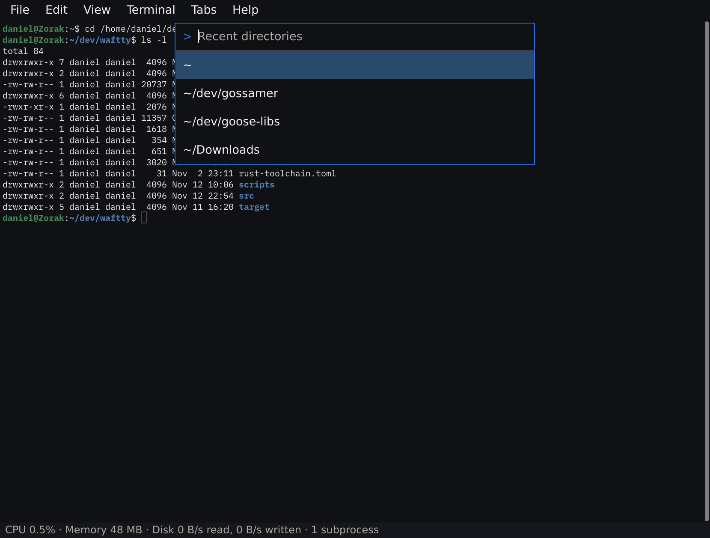

<svg viewBox="0 0 1000 400">
  <path d="M-10 90H230A18 18 0 1 0 212 72"/>
  <path d="M-10 128H140"/>
  <path d="M720 200H900A18 18 0 1 0 882 182"/>
  <path d="M800 238H1010"/>
  <path d="M-10 300H170A18 18 0 1 1 152 318"/>
  <path d="M850 110H1010"/>
</svg>

# waftty

A gentle terminal emulator - consistently lightweight on Linux, macOS and Windows.

  <a href="installation/" class="primary">Get waftty</a>
  <a href="https://github.com/danpozmanter/waftty" class="secondary">View on GitHub</a>

## Features

### Featherweight

Extremely low memory and CPU overhead. waftty stays out of your way, leaving resources for your applications.

### Fast and Responsive

Smooth terminal output and responsive typing, even when commands produce large amounts of text.

### Image Support

Display images directly in your terminal with support for modern graphics protocols like kitty.

### Keyboard-First Navigation

Copy text with Vim-style keyboard navigation, jump directly to links and file paths, and search your scrollback without reaching for the mouse.

### Command Palette

Ctrl+Shift+P (Cmd+Shift+P on macOS) runs any command by typing the start of its name, and Ctrl+Shift+R goes back to a recent directory. The menu bar can stay hidden.

### Private Windows and Tabs

Open a private window or tab to work in a temporary directory or run dangerous commands without history pollution.

### Shell-Aware and Agent-Ready

Jump between command prompts, select command output, and receive notifications from background tasks and coding agents such as Codex.

### Modern Terminal Features

Font ligatures, the kitty keyboard protocol, clickable code paths, customizable shortcuts, and themes.

## Built With

waftty is written in [Gossamer](https://github.com/gossamer-lang/gossamer) on the
[gui-gos](https://github.com/gossamer-lang/gui-gos) toolkit, built on a core of [Rust](https://rust-lang.org/) and [SDL3](https://github.com/libsdl-org/SDL).
  
Terminal emulation comes from a lite fork of [WezTerm's](https://wezterm.org/) terminal core [wezterm-lite](https://github.com/gossamer-lang/wezterm-lite).
